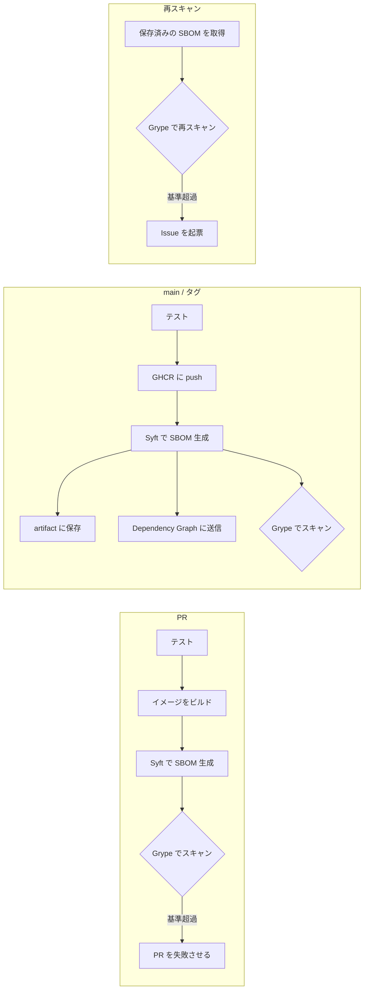

# sbom-training

SBOM(Software Bill of Materials)による依存管理・脆弱性管理を、小さなブログアプリケーションで一通り試すためのサンプルです。

- **api/** — Go の GraphQL API([gqlgen](https://gqlgen.com/)、PostgreSQL)
- **web/** — Next.js(App Router)のフロントエンド
- このサンプルが扱うのは **テストとコンテナイメージのビルドまで** で、デプロイは行いません

> [!NOTE]
> このリポジトリは作成時点のサンプルで、継続的なメンテナンスはしていません。依存は更新されないため、時間が経つと脆弱性のあるバージョンを含むようになります。そのため、定期実行(SBOM の再スキャン、Dependabot のバージョン更新)は止めてあり、外部からの Pull Request も受け付けていません。自分のリポジトリで試す場合の有効化の方法は[末尾](#自分のリポジトリで試す場合の-github-側の設定)にあります。

## SBOM の流れ



| いつ | 何をするか | 定義 |
| --- | --- | --- |
| PR | イメージをビルドして SBOM を生成し、基準を超える脆弱性があれば失敗させる | [ci.yml](.github/workflows/ci.yml) |
| main への push | イメージを GHCR に push し、その digest から SBOM を生成して artifact に保存する。パッケージ一覧を Dependency Graph に送る | [ci.yml](.github/workflows/ci.yml) |
| `v*` タグ | 上に加えて、SBOM を GitHub Release に添付する | [ci.yml](.github/workflows/ci.yml) |
| 再スキャン(手動。定期実行にもできる) | 保存済みの SBOM を最新の脆弱性データベースでスキャンし直し、基準を超えたら Issue を起票する | [sbom-rescan.yml](.github/workflows/sbom-rescan.yml) |
| 依存の更新(このリポジトリでは停止中) | 依存の更新 PR を作る(公開から 7 日の cooldown 付き) | [dependabot.yml](.github/dependabot.yml) |

運用の詳細は次のドキュメントにあります。

- [docs/sbom-operations.md](docs/sbom-operations.md) — SBOM の保存場所、脆弱性が見つかったときの対応
- [docs/dependency-policy.md](docs/dependency-policy.md) — 依存バージョンの選定基準(cooldown)

## ローカルで試す

必要なもの: Docker、Go 1.27、Node.js 24、[aqua](https://aquaproj.github.io/)(syft / grype の導入に使用)

```bash
aqua policy allow aqua-policy.yaml
```

```bash
aqua install
```

`aqua policy allow` は初回だけ必要です。grype の定義をこのリポジトリ内のファイル([aqua/registry.yaml](aqua/registry.yaml))で上書きしているため、明示的な承認が求められます(理由はファイル冒頭のコメントを参照)。

```bash
make test
```

```bash
make sbom
```

```bash
make scan
```

`make sbom` はイメージをビルドして `sbom/` に CycloneDX(`*.cdx.json`)と SPDX(`*.spdx.json`)を出力し、`make scan` はそれを [.grype.yaml](.grype.yaml) の基準でスキャンします。CI も同じスクリプト([scripts/](scripts/))を呼んでいます。

アプリケーションを動かす場合:

```bash
make up
```

http://localhost:3000 で Web、http://localhost:8080 で GraphQL Playground が開きます。`make down` で停止します。

## 構成

```
api/                  Go の GraphQL API
  graph/              スキーマ(schema.graphqls)とリゾルバ。generated.go は生成物
  internal/blog/      記事のドメイン型とストア(メモリ / PostgreSQL)
web/                  Next.js のフロントエンド
scripts/
  sbom-generate.sh    Syft で SBOM を生成
  sbom-scan.sh        Grype で SBOM をスキャン
  check-cooldown.sh   Go モジュールの cooldown チェック
.syft.yaml            SBOM に含める情報の設定
.grype.yaml           脆弱性ゲートの基準と除外
.cooldown-exempt      cooldown の例外
aqua.yaml             ローカル用 CLI のバージョン固定
```

## 自分のリポジトリで試す場合の GitHub 側の設定

このリポジトリをフォークまたは複製して動かす場合は、次を有効にします。

- **Dependency graph** と **Dependabot alerts**、**Dependabot security updates**(Settings → Advanced Security)
- Actions の **Workflow permissions** は既定(read)のままで構いません。必要な権限はワークフロー内で宣言しています

次の 2 つは public リポジトリでのみ動作し、private では自動でスキップします(private で使うには GitHub Code Security の契約が必要です)。

- スキャン結果の Code scanning への送信(SARIF)
- PR での依存関係の差分レビュー(dependency-review-action)

このリポジトリで止めてある定期実行は、次のように有効にします。

- **SBOM の再スキャン**: [sbom-rescan.yml](.github/workflows/sbom-rescan.yml) の `schedule` のコメントを外します。public リポジトリでは、60 日間リポジトリに動きがないと GitHub がスケジュール実行を自動で無効にするため、その場合は Actions の画面から有効に戻します。
- **Dependabot のバージョン更新**: [dependabot.yml](.github/dependabot.yml) の `open-pull-requests-limit: 0` の行を削除します。

再スキャンは手動でも実行できます。Release のタグを指定すると、そのリリースに添付された SBOM が対象になります。

```bash
gh workflow run sbom-rescan.yml
```

```bash
gh workflow run sbom-rescan.yml -f release=v0.1.0
```

CI が push するコンテナイメージ(`ghcr.io/benevolent0505/sbom-training/*`)は非公開です。イメージの中身は Release に添付した SBOM で確認できます。

## ライセンス

[MIT License](LICENSE)
