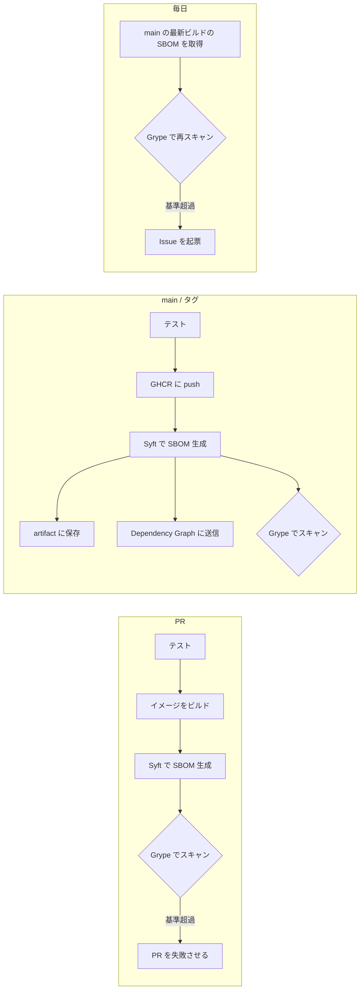

# sbom-training

SBOM(Software Bill of Materials)による依存管理・脆弱性管理を、小さなブログアプリケーションで一通り試すためのサンプルです。

- **api/** — Go の GraphQL API([gqlgen](https://gqlgen.com/)、PostgreSQL)
- **web/** — Next.js(App Router)のフロントエンド
- デプロイ先は ECS を想定していますが、このサンプルが扱うのは **テストとコンテナイメージのビルドまで** です

## SBOM の流れ



| いつ | 何をするか | 定義 |
| --- | --- | --- |
| PR | イメージをビルドして SBOM を生成し、基準を超える脆弱性があれば失敗させる | [ci.yml](.github/workflows/ci.yml) |
| main への push | イメージを GHCR に push し、その digest から SBOM を生成して artifact に保存する。パッケージ一覧を Dependency Graph に送る | [ci.yml](.github/workflows/ci.yml) |
| `v*` タグ | 上に加えて、SBOM を GitHub Release に添付する | [ci.yml](.github/workflows/ci.yml) |
| 毎日 | main の最新ビルドの SBOM を最新の脆弱性データベースで再スキャンし、基準を超えたら Issue を起票する | [sbom-rescan.yml](.github/workflows/sbom-rescan.yml) |
| 毎週 | 依存の更新 PR を作る(公開から 7 日の cooldown 付き) | [dependabot.yml](.github/dependabot.yml) |

運用の詳細は次のドキュメントにあります。

- [docs/sbom-operations.md](docs/sbom-operations.md) — SBOM の保存場所、脆弱性が見つかったときの対応、ECS との接続
- [docs/dependency-policy.md](docs/dependency-policy.md) — 依存バージョンの選定基準(cooldown)

## ローカルで試す

必要なもの: Docker、Go 1.27、Node.js 24、[aqua](https://aquaproj.github.io/)(syft / grype の導入に使用)

```bash
aqua policy allow aqua-policy.yaml
```

```bash
aqua install
```

`aqua policy allow` は初回だけ必要です。grype の定義をこのリポジトリ内のファイル([aqua/registry.yaml](aqua/registry.yaml))で上書きしているため、明示的な承認が求められます(理由はファイル冒頭のコメントを参照)。

```bash
make test
```

```bash
make sbom
```

```bash
make scan
```

`make sbom` はイメージをビルドして `sbom/` に CycloneDX(`*.cdx.json`)と SPDX(`*.spdx.json`)を出力し、`make scan` はそれを [.grype.yaml](.grype.yaml) の基準でスキャンします。CI も同じスクリプト([scripts/](scripts/))を呼んでいます。

アプリケーションを動かす場合:

```bash
make up
```

http://localhost:3000 で Web、http://localhost:8080 で GraphQL Playground が開きます。`make down` で停止します。

## 構成

```
api/                  Go の GraphQL API
  graph/              スキーマ(schema.graphqls)とリゾルバ。generated.go は生成物
  internal/blog/      記事のドメイン型とストア(メモリ / PostgreSQL)
web/                  Next.js のフロントエンド
scripts/
  sbom-generate.sh    Syft で SBOM を生成
  sbom-scan.sh        Grype で SBOM をスキャン
  check-cooldown.sh   Go モジュールの cooldown チェック
.syft.yaml            SBOM に含める情報の設定
.grype.yaml           脆弱性ゲートの基準と除外
.cooldown-exempt      cooldown の例外
aqua.yaml             ローカル用 CLI のバージョン固定
```

## GitHub 側の設定

リポジトリを作成したら、次を有効にします。

- **Dependency graph** と **Dependabot alerts**(Settings → Advanced Security)
- Actions の **Workflow permissions** は既定(read)のままで構いません。必要な権限はワークフロー内で宣言しています

private リポジトリでは、GitHub Code Security の契約が必要な次の 2 つを自動でスキップします。public にすると有効になります。

- スキャン結果の Code scanning への送信(SARIF)
- PR での依存関係の差分レビュー(dependency-review-action)
